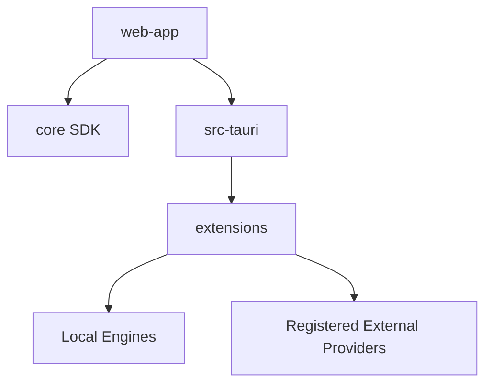

# Radium

Radium is a local-first AI application built with Tauri, Rust, React, and TypeScript that runs local models and exposes an OpenAI-compatible API.

  

<!-- SCREENSHOT PLACEHOLDER: hero image of Radium Chat interface -->
_Screenshot coming soon._

## Features
- Runs local models through provider extensions (`llamacpp-upstream`, `llamacpp`, `mlx`, `Apple Foundation Models`).
- Connects to external OpenAI-compatible model servers.
- Exposes a local OpenAI-compatible API for other apps.
- Supports chat transport and opt-in agent mode logic via Rust agent loops.

## Architecture

Radium integrates a React frontend (`web-app`), a shared TypeScript SDK (`core`), and a native shell (`src-tauri`). The architecture uses extensions to support diverse model runtimes and connected providers.

## Quick start
Requires Node.js 22.12+, Yarn 4.5.3, Rust, GNU Make, and native build prerequisites.
1. `git clone https://github.com/walladanger/Radium.git`
2. `cd Radium`
3. `make dev` (or `make dev-windows` on Windows)
4. `yarn lint`
5. `yarn test`
6. `make verify`

## Configuration
| Environment Variable | Purpose | Default |
| --- | --- | --- |
| `RADIUM_API_KEY` | Provides an API key for the local API server and authenticates requests | None |

## Screenshots
<!-- SCREENSHOT PLACEHOLDER: secondary image of Radium UI settings/chat -->
_Screenshot coming soon._

## Roadmap
See issues.

## License & credits
Apache-2.0 License. See [LICENSE](LICENSE) for details. Based on Atomic Chat.

See [Original Radium Overview](docs/original-readme.md) for detailed configuration, provider insights, and deep architectural mappings.
